# Full-Stack Learning

[](https://github.com/kushal721/fullstack-learning/actions/workflows/ci.yml)

An interactive website that teaches complete beginners how full-stack web
development actually works: from what happens when you type an address, through
HTML, CSS and JavaScript, to React, APIs, databases, security and deployment.
Everything is taught around one real application, a **Notes App**, that the
learner reads, follows and builds from an empty folder to a deployed website.

> **Don't just learn what to write. Understand what happens when you write it.**

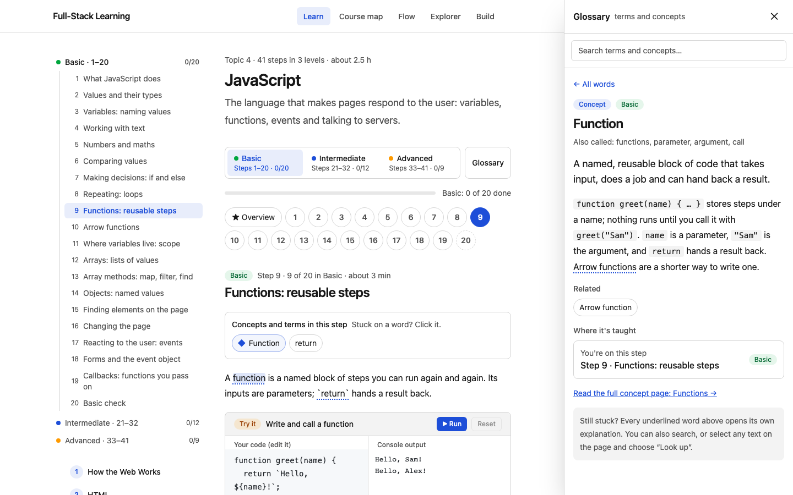

## Contents

- [What it does](#what-it-does)
- [Screenshots](#screenshots)
- [How the learning works](#how-the-learning-works)
- [Tech stack](#tech-stack)
- [Architecture](#architecture)
- [Repository layout](#repository-layout)
- [How the content is written](#how-the-content-is-written)
- [The Notes App](#the-notes-app)
- [API](#api)
- [Security](#security)
- [Quality: tests and checks](#quality-tests-and-checks)
- [How it was built](#how-it-was-built)
- [Getting started](#getting-started)
- [Run with Docker](#run-with-docker)
- [How changes reach production](#how-changes-reach-production)
- [Scripts](#scripts)
- [More documentation](#more-documentation)

## What it does

The site has five sections, in the main navigation:

| Section        | What the learner does there                                                                                                                                                                                                                           |
| -------------- | ----------------------------------------------------------------------------------------------------------------------------------------------------------------------------------------------------------------------------------------------------- |
| **Learn**      | Works through 14 topics in order. Each topic is a guided path of numbered steps in three levels: **Basic**, **Intermediate** and **Advanced**. Every difficult word links to the glossary panel, and code examples can be edited and run on the page. |
| **Course map** | Sees the whole course at once: every topic, its three levels, what each level covers, and their own progress.                                                                                                                                         |
| **Flow**       | Follows one request step by step, as an animated diagram, from a click in the browser through the API and database and back to the screen (create a note, log in, and more).                                                                          |
| **Explorer**   | Browses the Notes App's real source code: every file, why it exists, what it connects to, and how the project grows build step by step.                                                                                                               |
| **Build**      | Builds the Notes App in 14 steps, from "understand the application" to "deploy", with what changes and why at each step.                                                                                                                              |

Search (<kbd>⌘K</kbd> / <kbd>Ctrl K</kbd>) finds concepts, glossary terms, files, functions, build steps and connections from anywhere.

## Screenshots

> The screenshots are taken from the production build by `npm run screenshots`, so they can be refreshed whenever the UI changes.

### Home and the topic list

| Home                                    | Learn: the topics in order                |
| --------------------------------------- | ----------------------------------------- |
| 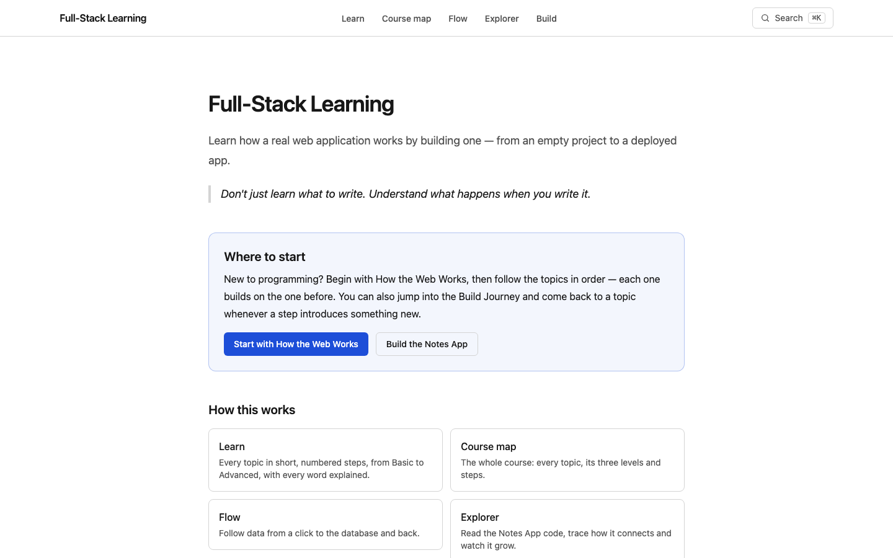 | 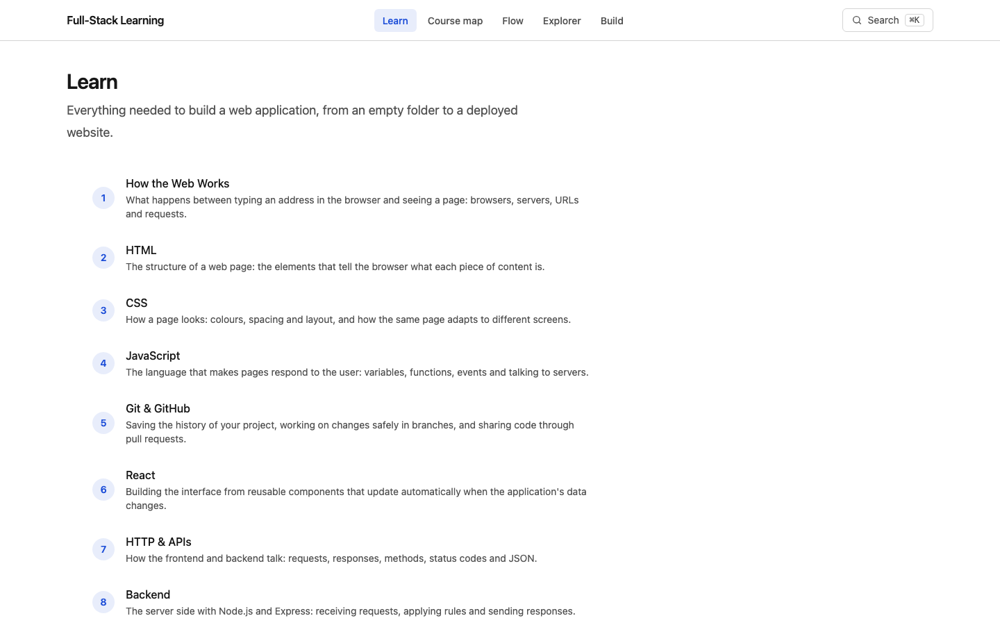 |

### A guided step

The sidebar lists every step of the level, the level switcher sits above the
numbered step dots, and the lesson shows the words it introduces. This HTML
step has a reference table of the real tags with examples.

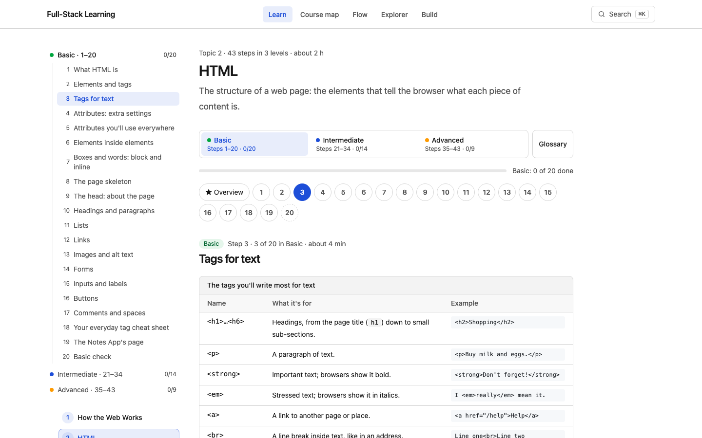

### A module: functions in depth

The step-through runs code one move at a time: the line, the variables,
the call stack and the output.

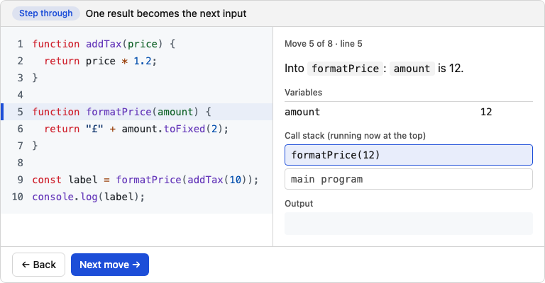

"Your turn" exercises run the learner's code against tests in the sandbox.
JavaScript exercises run tests such as `double(2) → 4`; page exercises
(HTML, CSS and the DOM) run checks on the page the learner built, such as
"the list has 3 items", "after clicking Add it has 4" or "the heading's
padding is 16px", and show ✓ or ✗ for each.

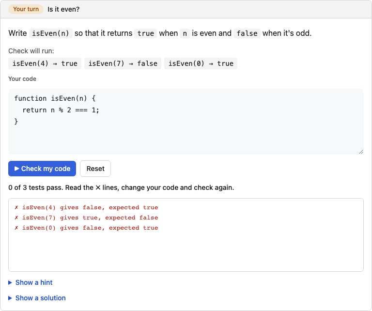

### Code you can run

JavaScript examples run in a safe sandbox on the page: edit the code, press
**Run**, and see the console output. HTML and CSS playgrounds show the
rendered result as you type. Page playgrounds run HTML, CSS and scripts
together, so DOM and event code works on a real page, with its console
shown underneath.

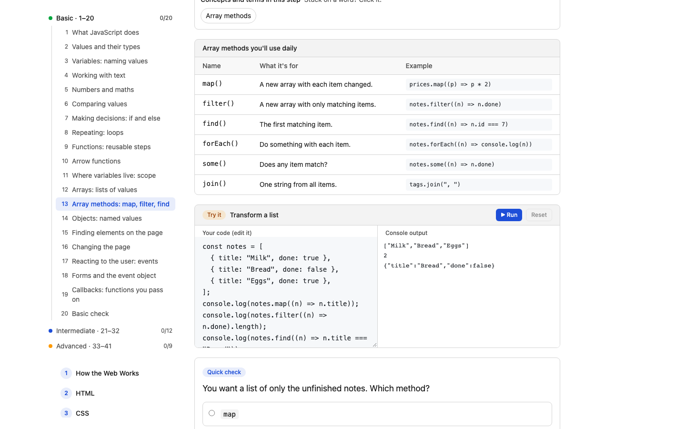

### Course map

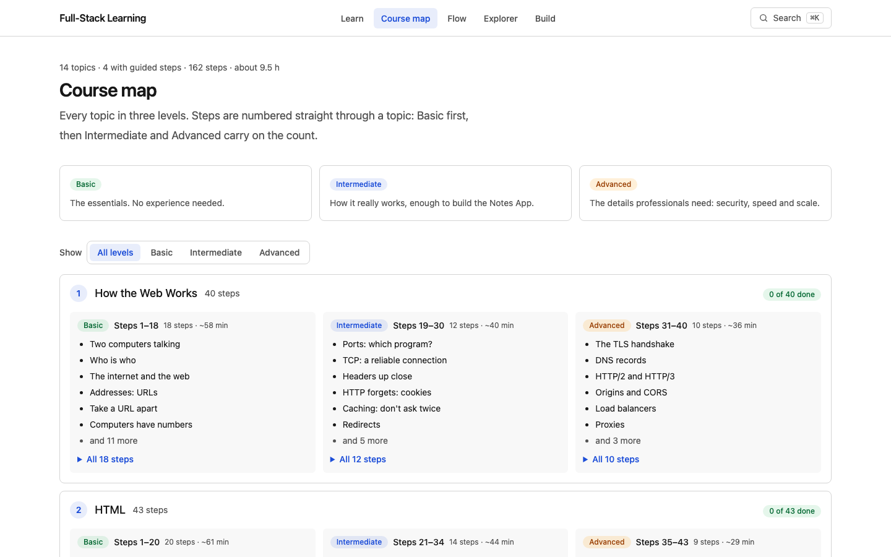

### Flow: follow a request

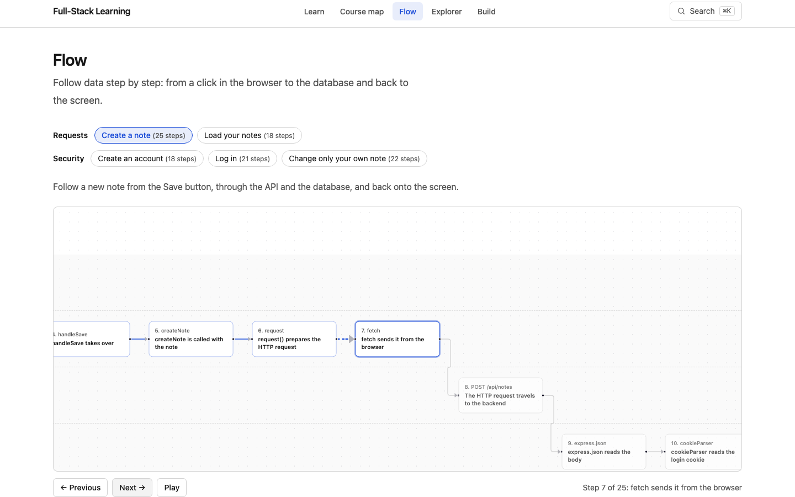

### Explorer and Build

| Explorer: how the Notes App grows               | Build: 14 steps to a deployed app         |
| ----------------------------------------------- | ----------------------------------------- |
| 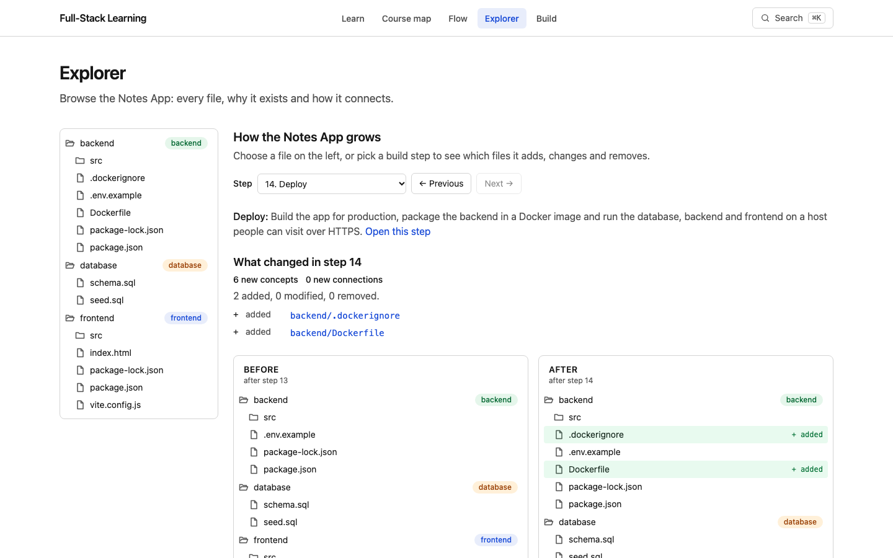 | 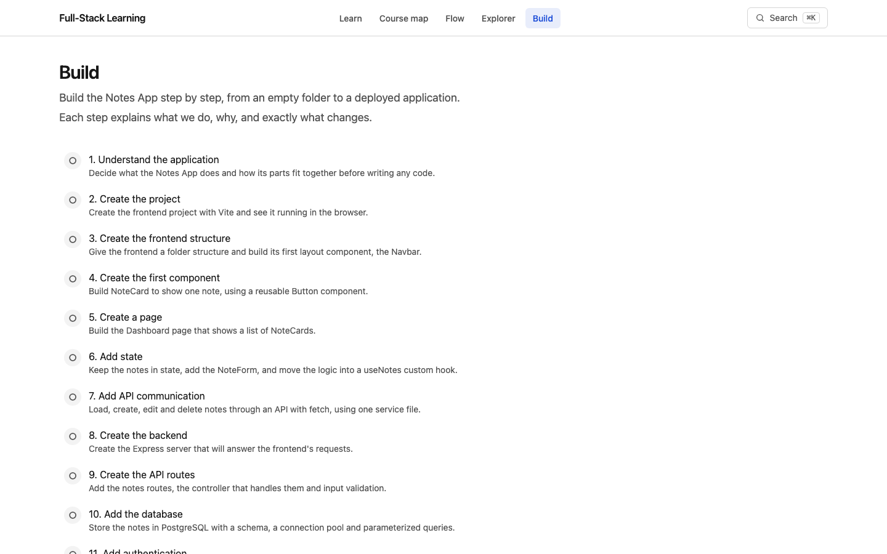 |

### Dark mode and phones

The site follows the system's light or dark setting and works from phone width up.

| Dark mode                                                  | Phone                                                                                 |
| ---------------------------------------------------------- | ------------------------------------------------------------------------------------- |
| 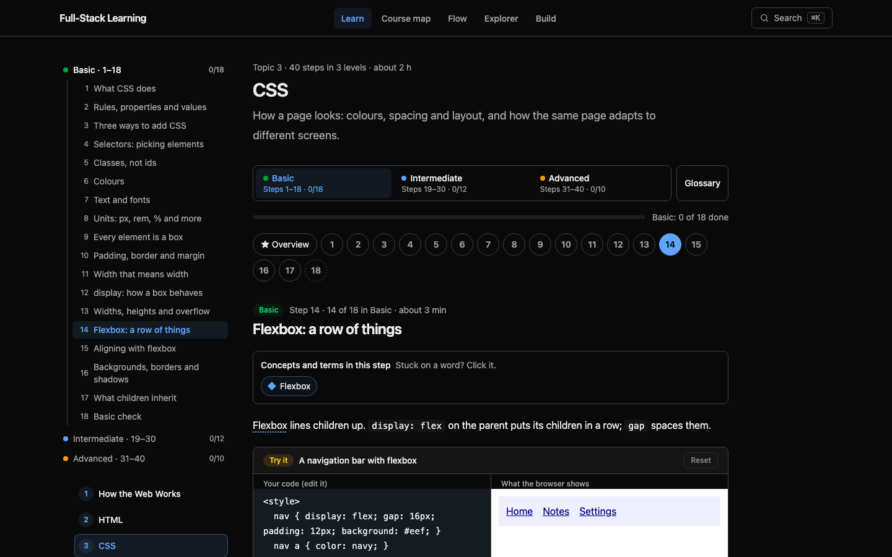 | 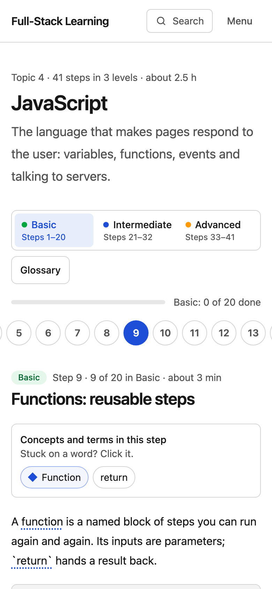 |

## How the learning works

- **Topics in order.** 14 topics, each building on the last: How the Web
  Works → HTML → CSS → JavaScript → Git & GitHub → React → HTTP & APIs →
  Backend → Databases → Authentication → Security → Testing → Deployment →
  How Everything Connects. Topics with a guided path so far: How the Web
  Works, HTML, CSS and JavaScript (74 steps); the rest show their classic
  topic page until their path is written.
- **Three levels, one count.** Every topic starts at Basic. Numbering carries
  on between levels (for example Basic 1–18, Intermediate 19–30, Advanced
  31–40), and the learner can switch levels at any time.
- **Steps made of blocks.** A step is a lesson or a check. A lesson is built
  from blocks: explanations, analogies, key points, diagrams, animated
  scenes, annotated code, reference tables (tags, properties, methods with
  examples), live playgrounds, interactive widgets, quick checks, and "In
  the Notes App" links to the real code.
- **Modules for the core ideas.** The ideas everything else depends on
  are taught in depth as modules: objectives first, then parts shown one
  at a time. JavaScript has twenty-one, one for every step but the level checks: Getting started (11 parts),
  Variables and values (12), Text and numbers (12), Making decisions
  (12), Loops (12), Functions (13), Arrays (12), Objects (13), The DOM
  (12), Events and forms (12), JSON and working with data (14), Async code (14), Handling errors (13), Modules and modern syntax (14), Reading real code (14), Scope and closures (13), The event loop (11), this and classes (14), Copies and references (13), TypeScript (14) and Debugging (14). Modules add labelled
  code ("anatomy"), a **step-through** that runs code line by line showing
  the variables, the call stack and the output, **common mistakes** shown
  wrong → right, and **"your turn" exercises**: the learner writes code
  and Check runs tests on it in the sandbox (a test that gives back a promise is awaited, so async code can be tested too). Every exercise's solution is
  run when the content is validated (page exercises in jsdom), and the
  browser check runs every page exercise's solution and starter in
  Chromium, where style checks need a real layout.
- **One page or part by part.** A module can be read one part at a time
  (the default) or as one long page with an "On this page" list; the
  choice is remembered in the browser.
- **No word left unexplained.** Every term is a link. Clicking one opens the
  **glossary panel** on the right, with a plain explanation, related words,
  where it is taught, and search. Words inside an explanation are links
  too, and any selected text can be looked up.
- **Checks.** Quick checks inside lessons, and a level check at the end of
  each level whose questions are marked on the server.
- **Progress** is saved in the browser (no account needed) and shown on the
  steps, the levels and the course map.

## Tech stack

The platform is itself a small full-stack application, built with the same
kinds of tools it teaches.

| Layer           | Technology                                                                               | Why                                                                                          |
| --------------- | ---------------------------------------------------------------------------------------- | -------------------------------------------------------------------------------------------- |
| Language        | **TypeScript** everywhere                                                                | One language for client, server and content, with types shared between them                  |
| Client          | **React 19**, **Vite 8**, **React Router 8**                                             | A fast single-page app; Vite for instant reloads and small production builds                 |
| Styling         | **Tailwind CSS 4**                                                                       | Consistent design tokens, light and dark themes, responsive layouts                          |
| Diagrams        | **React Flow** (`@xyflow/react`) with **dagre** layout                                   | The animated request flows and connection graphs                                             |
| Code display    | **Prism** (`prism-react-renderer`)                                                       | Syntax-highlighted, annotated code examples                                                  |
| Server          | **Node.js 22**, **Express 5**                                                            | Serves the content API and, in production, the built React app from one process              |
| Server security | **Helmet** (CSP and security headers), **express-rate-limit**, **cors**, **compression** | Safe defaults for a public site                                                              |
| Logging         | **pino** / **pino-http**                                                                 | Structured request logs                                                                      |
| Content         | TypeScript data in `server/src/content`, checked by `npm run validate`                   | Content is code: typed, reviewed in pull requests, and validated before it ships             |
| Unit tests      | **Vitest 5**, **Testing Library**, **jsdom**, **supertest**                              | Fast tests for components, routes and content rules                                          |
| Browser tests   | **Playwright** with **axe-core**                                                         | Every page in a real browser at phone and desktop widths, light and dark, plus accessibility |
| Code quality    | **ESLint 9**, **Prettier 3**, **lint-staged** with **simple-git-hooks**                  | The same style everywhere, checked before each commit                                        |
| Packaging       | **Docker** (multi-stage, Alpine, non-root) and **Docker Compose**                        | The same image runs locally and in production                                                |
| CI/CD           | **GitHub Actions** → **GitHub Container Registry** → **Render**                          | Every pull request is checked; every merge to `main` is published and deployed               |
| Repository      | **npm workspaces** monorepo                                                              | Client, server and shared types in one place, installed and checked together                 |

The **Notes App** that learners study and build uses: React 19 + Vite
(frontend), Node.js + Express 5 (backend), **PostgreSQL** with `pg`
(database), **bcrypt** and **JSON Web Tokens** in an httpOnly cookie
(authentication), and Vitest + Testing Library + supertest (tests).

The platform itself uses **no AI at runtime**: every explanation, question
and diagram is written content, served from the API.

## Architecture

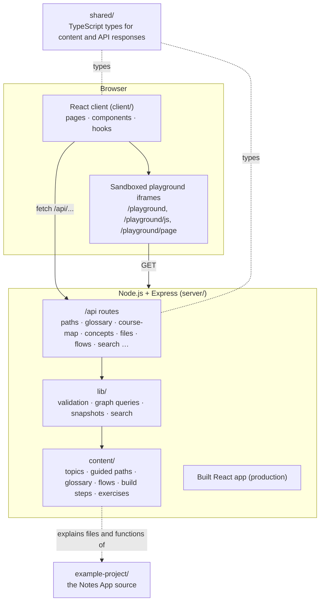

- **One process in production.** The Docker image runs Express, which serves
  the API under `/api`, the playground pages under `/playground`, and the
  built React app for every other path.
- **No database for the platform.** All content is structured TypeScript
  data on the server; learner progress lives in the browser's
  `localStorage`.
- **One source of truth.** Content refers to things by id (concepts,
  glossary terms, Notes App files and functions, build steps), and the
  validator fails the build if any reference is broken.

Request path for a guided step:

```text
Click step 6 ─► React Router: /learn/javascript/functions
             ─► services/api.ts: GET /api/paths/javascript/steps/functions
             ─► Express route ─► content + glossary lookups (answers removed)
             ─► JSON ─► StepPlayer renders the blocks; words become glossary links
```

## Repository layout

```text
client/              React app (Vite)
  src/pages/         one component per URL
  src/components/    features: learn-path/ (guided learning), flow-tracer/, file-explorer/,
                     build-journey/, project-evolution/, search/, layout/, ui/ …
  src/hooks/         data loading, progress (localStorage)
  src/services/      api.ts, the only code that calls fetch()
server/              Express API
  src/routes/        one router per resource, plus the playground pages
  src/lib/           content validation, search, graph and snapshot logic
  src/content/       all learning content, as TypeScript data
    paths/           guided paths: one folder per topic (basic, intermediate, advanced)
    glossary/        terms and concepts, one file per topic
    concepts/        full concept pages
    flows/           request flows for the Flow page
    build-steps/     the 14 Notes App build steps
    exercises/       level-check questions and practice exercises
  scripts/           validate-content.ts (npm run validate)
shared/              TypeScript types used by client and server
example-project/     the Notes App: frontend/, backend/, database/
e2e/                 Playwright browser checks
scripts/             browser check, screenshots, git hooks
docs/                Notes App specification, screenshots
.github/workflows/   ci.yml, release.yml
```

## How the content is written

Lessons are TypeScript, written with small helpers so a step file reads like
the lesson itself:

```ts
lesson(
  "functions",
  "Functions: reusable steps",
  3,
  explain("A [[js-function|function]] is a named block of steps …"),
  jsPlayground("Write and call a function", [
    "function greet(name) {",
    "  return `Hello, ${name}!`;",
    "}",
    'console.log(greet("Sam"));',
  ]),
),
```

- `[[id]]` and `[[id|label]]` link a glossary term; the client turns them
  into links that open the panel.
- `npm run validate` checks every rule before anything ships: level sizes,
  a check at the end of each level, block size limits, quick checks spread
  through lessons, every link resolving, every topic's terms introduced by
  its own steps (and not used before they are introduced), and every
  level-check question tied to a step of that level.

## The Notes App

The Notes App in [`example-project/`](example-project/) is a real,
working application and the thread through the whole course: users register,
log in, and create, edit and delete their own notes.

- `frontend/`: React components → hooks (`useNotes`) → services (`request.js`, `notesApi.js`) → `fetch`.
- `backend/`: Express routes → controllers → parameterized SQL; validation; auth middleware.
- `database/`: `schema.sql` and `seed.sql` for PostgreSQL.

Lessons link straight to its files and functions (for example
`handleSave` in `NoteForm.jsx`), the Explorer shows each file with its
explanation, and the Flow page animates its requests. Its full design is in
[docs/NOTES_APP.md](docs/NOTES_APP.md).

## API

All under `/api`, JSON, read-only except answer checks:

| Endpoint                                    | Returns                                                         |
| ------------------------------------------- | --------------------------------------------------------------- |
| `GET /api/health`                           | Status and running version                                      |
| `GET /api/topics`, `/api/topics/:slug`      | The topic tree and topic pages                                  |
| `GET /api/paths/:topic`                     | A topic's guided path: levels, numbered steps, scenes           |
| `GET /api/paths/:topic/steps/:step`         | One step's blocks and its glossary (answers removed)            |
| `POST /api/paths/:topic/steps/:step/check`  | Marks a quick-check answer                                      |
| `GET /api/glossary`, `/api/glossary/:id`    | Glossary terms, with where each is introduced and used          |
| `GET /api/course-map`                       | Every topic with its levels, step counts and what they cover    |
| `GET /api/concepts`, `/api/concepts/:slug`  | Full concept pages                                              |
| `GET /api/files/*path`, `/api/symbols/:id`  | Notes App files and functions with explanations and graphs      |
| `GET /api/build-steps`, `/api/project/diff` | The build journey, project snapshots and what each step changed |
| `GET /api/flows`, `/api/flows/:id`          | Request flows for the Flow page                                 |
| `GET /api/exercises`, `POST …/check`        | Level-check questions, marked on the server                     |
| `GET /api/search?q=`                        | Grouped search results                                          |

## Security

- **Strict Content Security Policy** on every page via Helmet: scripts,
  styles and connections only from the site itself.
- **Playgrounds are isolated.** Learner code never runs in the site's page:
  - HTML/CSS previews load `/playground` in an iframe with an empty
    `sandbox` (no scripts at all) and their own policy allowing only inline
    styles.
  - JavaScript runs from `/playground/js` in an iframe sandboxed to
    `allow-scripts` only (a unique origin with no cookies or storage), under
    a policy with no network access, inside a Web Worker that is stopped
    after 2 seconds so an endless loop can't freeze the page. The code is
    JSON-encoded with `<` escaped so it can't break out of its script.
  - Pages with scripts (DOM examples and page exercises) load
    `/playground/page` in an iframe sandboxed to `allow-scripts allow-forms`
    (a unique origin, no cookies or storage), under a policy with no
    network access and `form-action 'none'`, so a form fires its submit
    event but can't be sent anywhere. Exercise checks are JSON-encoded
    with `<` escaped, and the step only accepts results from its own
    frame.
- **Rate limits** per IP for the API and for answer checks.
- Answers are removed from steps and checked on the server.
- The Docker image runs as a non-root user and reports health at `/api/health`.

## Quality: tests and checks

Every pull request must pass, and the same checks run locally with
`npm run check`:

- **Formatting and lint**: Prettier and ESLint (also on every commit via a git hook).
- **Types**: `tsc` in every workspace.
- **Content validation**: `npm run validate`.
- **Unit and integration tests** (about 730): React components with Testing
  Library, every API route with supertest, content rules, search and the
  playground pages.
- **Browser check** (`npm run check:browser`): Playwright opens every page
  and every guided step of the production build at phone width (light and
  dark) and desktop width, fails on console errors or horizontal
  scroll, runs **axe** accessibility scans, tests keyboard use,
  and checks that a JavaScript playground really runs and stops an endless
  loop.
- **Docker image** build.

## How it was built

- **Built by** Kushal Bhatta, with **[Claude Code](https://claude.com/claude-code)**,
  Anthropic's AI coding agent, running the model **Claude Opus 5.5**
  (`claude-opus-5-5`).
- **How the work was split:** Kushal set the vision, chose the stack (React + Node.js, no
  Next.js), decided what to build next and reviewed the results. Claude
  Code turned the plan into a roadmap of GitHub issues and implemented
  them one at a time: code, content, tests, pull request and self-review.
- **Workflow:** every change follows the same cycle, tracked on a GitHub project
  board: issue → branch → implementation → `npm run check` and the browser
  check → pull request → CI → review → squash merge. The roadmap is split
  into milestones (M1 Foundation … M12 Guided Learning); see
  [PROJECT.md](./PROJECT.md).

## Getting started

Requirements: **Node.js 22** (see `.nvmrc`) and npm. Docker is optional.

```bash
npm install
npm run dev
```

- Client (Vite): <http://localhost:5173>, which forwards `/api` and `/playground` to the API
- API (Express): <http://localhost:3000/api/health>

## Run with Docker

### Development (hot reload)

```bash
docker compose up
```

- Client: <http://localhost:5173> (forwards `/api` to the server container)
- API: <http://localhost:3000/api/health>

Your source folder is mounted into the containers, so saving a file reloads
the server or updates the page. Dependencies are installed inside the
containers (in Docker volumes) because some packages need Linux builds. After
changing dependencies, run `docker compose run --rm deps` (or
`docker compose down -v` to start fresh).

### Production image

The production image runs one Node.js process that serves the API under
`/api` and the built React app for every other path.

```bash
docker compose --profile prod up --build app   # http://localhost:8080
```

or without Compose:

```bash
docker build -t fullstack-learning .
docker run --rm -p 3000:3000 fullstack-learning   # http://localhost:3000
```

The container reports its health using `/api/health`.

## How changes reach production

```text
pull request ─► CI: audit, format, lint, typecheck, validate, test, build, browser check, Docker build
      │ (review, squash-merge)
      ▼
main ─► CI again ─► Release: build that exact commit and publish
                    ghcr.io/kushal721/fullstack-learning:sha-<commit> and :latest
                        │
                        ▼
                    Deploy: Render runs sha-<commit>; the job waits until
                    /api/health on the live site reports that commit
```

- Workflows: [`.github/workflows/ci.yml`](.github/workflows/ci.yml) and [`release.yml`](.github/workflows/release.yml). Both can also be started by hand from the Actions tab.
- The deploy step runs once the repository variable `RENDER_SERVICE_URL` and the secret `RENDER_DEPLOY_HOOK_URL` are set.
- On Render, set `PUBLIC_URL` to the site's address (used in `/sitemap.xml` and link previews).
- On Render, set the service's environment variable `TRUST_PROXY=1`: the API sits behind Render's proxy, and the rate limit needs each visitor's real IP. All server settings are listed in [`server/.env.example`](server/.env.example).

## Scripts

| Command                 | What it does                                                    |
| ----------------------- | --------------------------------------------------------------- |
| `npm run dev`           | Run client and API together with reload                         |
| `npm run lint`          | Lint the whole repo with ESLint                                 |
| `npm run format`        | Format files with Prettier                                      |
| `npm run format:check`  | Check formatting without changing files                         |
| `npm run typecheck`     | Type-check every workspace                                      |
| `npm test`              | Run tests in every workspace                                    |
| `npm run build`         | Build every workspace                                           |
| `npm run validate`      | Check the learning content: ids, links and lesson rules         |
| `npm run check`         | Run every CI check (format, lint, types, content, tests, build) |
| `npm run check:browser` | Build, start the production server and run the Playwright check |
| `npm run screenshots`   | Retake the README screenshots in `docs/screenshots/`            |

### Make (optional)

If you have `make`, the same tasks have short names. Run `make` on its own to
list them. Every target just calls the npm script or Docker command above, so
npm works everywhere (including Windows) and `make` is a convenience.

| Command            | What it does                                      |
| ------------------ | ------------------------------------------------- |
| `make install`     | `npm ci` — install exactly what the lockfile says |
| `make dev`         | Run the API and client with reload                |
| `make check`       | Run every CI check                                |
| `make test`        | Run all tests                                     |
| `make docker-dev`  | Dev stack in Docker (`docker compose up`)         |
| `make docker-prod` | Production image with Compose on :8080            |
| `make docker-run`  | Build and run the production image on :3000       |
| `make clean`       | Delete build output and coverage                  |

## More documentation

- [PROJECT.md](./PROJECT.md): vision, systems, architecture, roadmap
- [CONTRIBUTING.md](./CONTRIBUTING.md): workflow, conventions, checks
- [docs/NOTES_APP.md](docs/NOTES_APP.md): the Notes App specification
- [Product specification](./FULLSTACK_LEARNING_PROJECT_SPEC.md): the source of truth
